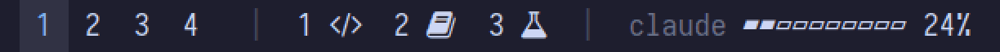

<div align="center">

<h1>ccoverseer</h1>

<p><strong>Know which Claude Code agent needs you, without leaving your workspace.</strong></p>

<p>Per-workspace status badges and a rate-limit bar for i3 + polybar.</p>

<p>
  <a href="https://github.com/maahumada/ccoverseer/actions/workflows/ci.yml"></a>
  <a href="LICENSE"></a>
  <a href="https://www.shellcheck.net/"></a>
  
  <a href="https://code.claude.com/docs/"></a>
</p>



<p>
  <a href="#quick-start">Quick start</a> ·
  <a href="#how-it-works">How it works</a> ·
  <a href="#configuration">Configuration</a> ·
  <a href="#demo-and-theme-preview">Demo</a>
</p>

</div>

Track parallel [Claude Code](https://code.claude.com/docs/) sessions from your
i3 + polybar status bar. Each workspace that hosts a session gets a badge
that shows whether the agent is working, finished, idle, or blocked waiting
for you.

```
 1  2 ◐  3 ●  4  5 ▲  6 ○        ▰▰▰▱▱▱▱▱▱▱ 31%
      │    │       │    │         └ 5-hour rate-limit window
      │    │       │    └ idle: finished more than 10 minutes ago
      │    │       └ blocked: waiting for a permission or an answer
      │    └ done: waiting for your next prompt
      └ working
```

Clicking a badge jumps to its workspace. The badge follows the terminal if
you move it to another workspace.

The full demo bar (fake workspaces on the left, the clock on the right):


## Requirements

- i3 (X11), polybar
- `jq`, `xprop` (Debian/Ubuntu: `sudo apt install jq x11-utils`)
- Claude Code with hooks support
- A terminal that sets `$WINDOWID`, which covers alacritty, kitty, xterm,
  urxvt and st. Other terminals are found by walking the process tree (see
  [Limitations](#limitations)).

## Quick start

```sh
git clone https://github.com/maahumada/ccoverseer ~/src/ccoverseer
~/src/ccoverseer/install.sh --merge-settings   # backs up ~/.claude/settings.json first
```

Then add the modules to your polybar config (see
`renderers/polybar/modules.ini`):

```ini
[module/ccoverseer]
type = custom/script
exec = ~/.local/share/ccoverseer/renderers/polybar/agents.sh
interval = 2
```

New Claude Code sessions are tracked automatically. Sessions that were
already open start being tracked after you restart them, because hooks are
read at session start.

If you prefer to edit `settings.json` yourself, run `./install.sh` without
flags and copy the blocks from `core/settings.example.json`.

## How it works

```
Claude Code hooks ──► core/hooks/state.sh ──┐
Claude Code statusLine ► core/usage-tap.sh ─┤ write
(opt-in) core/hooks/icon.sh ────────────────┘
                                            ▼
                       ~/.cache/ccoverseer/{agents,icons}/<key>, usage.json
                                            │ read every 2 s
                                            ▼
               renderers/polybar/*.sh + lib/resolver/i3.sh (window → workspace)
```

| Hook event | State |
|---|---|
| `UserPromptSubmit` | working |
| `PostToolUse` | working. This clears *blocked* once you approve a permission and the tool runs. |
| `Notification` (`permission_prompt`, `elicitation_dialog`) | blocked |
| `Stop` | done (becomes idle after 10 minutes) |
| `SessionEnd` | removed |

Hooks only write a small file; the bar never calls Claude Code. The file
format is a documented contract
([docs/cache-contract.md](docs/cache-contract.md)), so you can write a
renderer for another bar without reading the hook code.

## Rate-limit bar

`core/usage-tap.sh` is a statusLine command that stores the `rate_limits`
block Claude Code sends on every turn. `renderers/polybar/usage.sh` draws
it. Claude Code allows only one statusLine. If you already use one, keep it
by setting `CCO_STATUSLINE_NEXT` in `~/.config/ccoverseer/config`. The tap
forwards the payload to it and prints its output.

## Optional: topic icons (sends data, opt-in)

`core/hooks/icon.sh` asks Claude Haiku, once per session, which topic the
session is about (frontend, data, infra, bot…). The badge then alternates
between the state glyph and a topic icon, so the strip stays narrow. It is
**not installed by default**. Enable it with
`./install.sh --merge-settings --with-icons`.

- **Privacy:** it sends the repository name, the first 1500 bytes of its
  README and the first 500 characters of your first prompt through your own
  `claude` CLI. Reduce this with `CCO_ICON_CONTEXT` (for example
  `CCO_ICON_CONTEXT="repo"`).
- **Cost:** one small Haiku request per session, billed to your plan.
- Labels and glyphs are in `core/labels.tsv`. Copy the file to
  `~/.config/ccoverseer/labels.tsv` to adapt them to your projects. The glyphs
  need a Nerd Font.

## Configuration

All settings are optional shell variables in `~/.config/ccoverseer/config`.
See [`config.example`](config.example): glyphs, polybar font per state, idle
timeout, bar width, terminals to detect.

With topic icons on, each badge alternates between two glyphs of different
widths. By default the hidden one is still drawn, in a transparent color,
so the badge keeps the same width and nothing next to the module moves.
Set `CCO_STABLE_WIDTH=0` for narrower badges that change width.

## Limitations

- Supports i3 + polybar on X11. Sway and Hyprland only need a resolver in
  `lib/resolver/` (see the contract), and Waybar needs a renderer.
  Contributions welcome.
- Inside tmux, `$WINDOWID` is the one inherited when the tmux server
  started. Badges are correct if each tmux session lives in its own terminal.
- Terminals that run all windows from a single process
  (`gnome-terminal-server`) cannot be told apart by PID.
- The `rate_limits` schema belongs to Claude Code and may change. The bar
  shows `claude --` when it cannot read it.

## Demo and theme preview

The GIF at the top was recorded with `scripts/demo.sh`, which you can also
use to preview your own bar theme. It plays a 12-second scenario through
every state: three agents start, one finishes, one asks for permission and
is approved, one goes idle, and the usage bar climbs. It writes to its own
cache in `/tmp` and leaves your real sessions alone.

```sh
scripts/demo.sh polybar          # opens a demo bar (scripts/demo-polybar.ini)
eval "$(scripts/demo.sh env)"    # or point your own bar/renderer at the demo cache
scripts/demo.sh play
```

## Development

```sh
./test/run.sh                         # no X11 / i3 / Claude needed
shellcheck -x install.sh scripts/*.sh lib/*.sh lib/resolver/*.sh core/*.sh core/hooks/*.sh renderers/*/*.sh
```

## License

MIT
